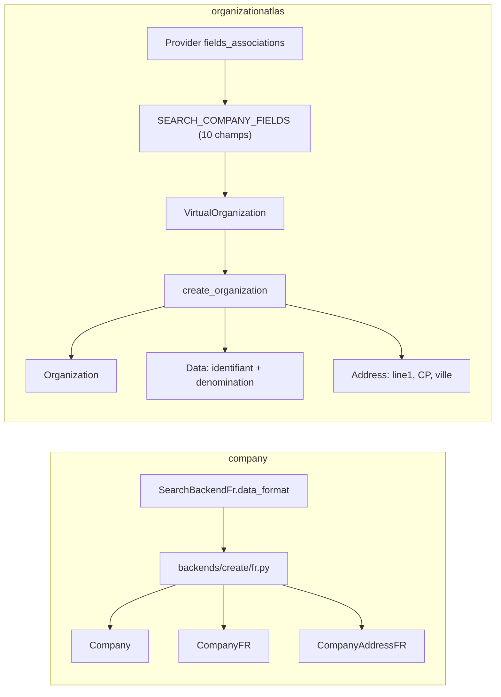

# Création de sociétés : `company` (Octolo) vs `organizationatlas`

Comparaison des informations **collectées et persistées** lors de la création d'une
société dans l'app Django `company` d'Octolo (`backend/company`) et dans
`organizationatlas` (`python-organizationatlas` + `django-organizationatlas`).

## Conclusion

`organizationatlas` **ne collecte pas** aujourd'hui toutes les informations que `company`
persiste à la création. Il ne garde que :

- la dénomination ;
- **un seul** identifiant (siren, siret ou RNA selon le provider) ;
- une adresse réduite (ligne 1, code postal, ville).

`company` persiste en plus une quinzaine de champs SIRENE (forme juridique, APE,
date de création, catégorie, tranche d'effectif, siège, compléments d'adresse…).

### Cause

`create_organization` ([`helpers.py`](../src/django_organizationatlas/helpers.py)) persiste
via `_iter_data_fields` les champs du modèle virtuel `OrganizationAtlasVirtualOrganization`.
Ces champs sont générés à partir de `ORGANIZATIONATLAS_SEARCH_COMPANY_FIELDS`
([`organizationatlas/__init__.py`](../../python-organizationatlas/src/organizationatlas/__init__.py)),
qui ne contient que :

| Champ | Persisté ? |
|---|---|
| `denomination` | oui (sur `Organization` + une ligne `Data`) |
| `reference` | oui (`Organization.code` + une ligne `Data` de type `source_field`) |
| `source_field` | utilisé comme `data_type` de l'identifiant |
| `country_code` | sur les enregistrements |
| `address` / `address_json` | `OrganizationAtlasAddress` |
| `organizationatlas_id`, `data_source`, `backend`, `backend_name` | non (`_SKIP_FIELDS`) |

`organizationatlas` n'a pas vocation à reproduire les colonnes nommées de `CompanyFR` :
l'architecture est générique et chaque information doit atterrir dans l'un de ces
conteneurs :

- **`OrganizationAtlasData`** : une ligne par information, `data_type` libre (`siren`,
  `legalform`, `ape`…), `value` + `value_type`, provenance (`source`, `country_code`) et
  validité temporelle (`valid_from` / `valid_to`) ;
- **`OrganizationAtlasReferentiel`** : les libellés et classifications (APE, forme
  juridique, tranche d'effectif…), liés à la ligne `Data` via le M2M `referentiel` ;
- **`OrganizationAtlasAddress`** : un `GeoaddressField` qui accepte déjà `address_line2`,
  `address_line3`, `number`, `street`, `sorting_code` (CEDEX), `po_box`, `country_code`… ;
- **`OrganizationAtlasOrganization.organization_type`** : la classification fonctionnelle
  (association, etc.), elle aussi un `Referentiel`.

Les conteneurs existent donc. Ce qui manque, c'est le **transport** : les providers ne
remontent que les dix champs du schéma de recherche, et `create_organization` ne
produit des lignes `Data` qu'à partir de ces champs. Les informations SIRENE sont bien
présentes dans la réponse brute des API, mais elles n'arrivent jamais jusqu'à `Data`,
`Address` ou `Referentiel`. (`FRANCE_FIELDS_DESCRIPTIONS` liste ces informations mais
n'est utilisé nulle part.)

## 1. Ce que `company` collecte et persiste

Sources :

- `backend/company/backends/search/fr/__init__.py` : `SearchBackendFr.data_format`
- `backend/company/backends/search/fr/{insee,entdatagouv,opendatasoft}.py` : mapping par API
- `backend/company/backends/create/fr.py` : création
- `backend/company/models/company.py` : `pre_update`, `prepare_kind`
- `backend/company/signals.py` : `DefaultSiegeFR`

### `Company`

| Champ | Origine |
|---|---|
| `denomination` | résultat de recherche |
| `since` | date de création de l'unité légale |
| `is_type` | `ASSOCIATION` si un RNA est présent (création + signal), sinon `COMPANY` |
| `named_id` | `slug(denomination)` + siren ou RNA |
| `siege_fr` / `siege_fr_address` | `CompanyFR` / `CompanyAddressFR` marqués siège |
| `stackholder_kind` / `stock_kind` | déduits de `legalform` (`STACKHOLDER_DEFAULT`, `STOCK_DEFAULT`) ou du type (association, copropriété) |

### `CompanyFR`

| Champ | INSEE | entdatagouv | opendatasoft |
|---|---|---|---|
| `siren` | `siren` | `siren` | `siren` |
| `siret` | `siret` | `siege.siret` | `siret` |
| `rna` | `uniteLegale.identifiantAssociationUniteLegale` | `id_association` | `identifiantassociationunitelegale` |
| `denomination` | `denominationUniteLegale`, repli `nomUniteLegale` | `nom_complet`, `nom_raison_sociale` | `denominationunitelegale` |
| `legalform` | `categorieJuridiqueUniteLegale` | `nature_juridique` | `categoriejuridiqueunitelegale` |
| `ape` (sans les points) | `activitePrincipaleUniteLegale` | `siege.activite_principale` | `activiteprincipaleunitelegale` |
| `ape_noun` | `nomenclatureActivitePrincipaleUniteLegale` | — | `nomenclatureactiviteprincipaleunitelegale` |
| `since` | `dateCreationUniteLegale` | `date_creation` | `datecreationunitelegale` |
| `category` | `categorieEntreprise` | `categorie_entreprise` | `categorieentreprise` |
| `slice_effective` | `trancheEffectifsUniteLegale` | `siege.tranche_effectif_salarie` | `trancheeffectifsunitelegale` |
| `siege` | `etablissementSiege` | `siege.est_siege` | `etablissementsiege == "oui"` |

### `CompanyAddressFR`

| Champ | Contenu |
|---|---|
| `address` | numéro + type + libellé de voie |
| `complement` | complément d'adresse |
| `locality` | commune (ou commune étrangère) |
| `postal_code` | code postal (repli code commune) |
| `country` / `country_code` | pays étranger si présent, sinon `france` / `fr` |
| `cedex` / `cedex_code` | libellé et code CEDEX |
| `special` | distribution spéciale |
| `index` | indice de répétition (bis, ter…) |
| `nic` | NIC de l'établissement |
| `raw` | adresse complète calculée |

Les libellés `ape_str`, `legalform_str` et `slice_str` sont affichés à partir de
`choices/fr.py` mais **ne sont pas stockés**.

## 2. Ce que `organizationatlas` collecte et persiste

| Modèle | Champs renseignés |
|---|---|
| `OrganizationAtlasOrganization` | `denomination`, `code` (= `reference`), `source`, `country_code`, `named_id`. `organization_type` jamais renseigné. |
| `OrganizationAtlasData` | une ligne `data_type = source_field` (siren / siret / rna) et une ligne `denomination` |
| `OrganizationAtlasAddress` | `address_line1`, `postal_code`, `city`, `country`, `country_code`, `is_headquarters=True` en dur |

`data_source` vaut `str(raw)` (repr Python, pas du JSON). Il est calculé mais ignoré à
la création : la réponse brute du provider est perdue.

## 3. Écarts par information

La colonne « Cible » indique où l'information doit atterrir dans l'architecture
générique ; le statut dit si elle y arrive aujourd'hui.

| Information (`company`) | Cible dans `organizationatlas` | Statut |
|---|---|---|
| Dénomination | `Organization.denomination` + `Data(data_type="denomination")` | collectée |
| Identifiant lisible (`named_id`) | `Organization.named_id` (denomination + code) | collectée |
| SIREN | `Data(data_type="siren")` | partielle : seulement si c'est la `reference` du provider |
| SIRET | `Data(data_type="siret")` | partielle : idem |
| RNA | `Data(data_type="rna")` | partielle : idem |
| Forme juridique | `Data(data_type="legalform")` + `Referentiel(category="legalform")` | non collectée |
| Code APE | `Data(data_type="ape")` + `Referentiel(category="ape")` | non collectée |
| Nomenclature APE (`ape_noun`) | `Data(data_type="ape_noun")` ou `metadata` de la ligne `ape` | non collectée |
| Date de création (`since`) | `Data(data_type="since")` (ou `valid_from` de l'organisation) | non collectée |
| Catégorie (PME, ETI, GE) | `Data(data_type="category")` + `Referentiel(category="category")` | non collectée |
| Tranche d'effectif | `Data(data_type="slice_effective")` + `Referentiel(category="slice_effective")` | non collectée |
| Siège | `Address.is_headquarters` | partielle : `True` en dur, non lu depuis la source |
| Association | `Organization.organization_type` → `org_type.association` | non collectée (le référentiel existe) |
| `stackholder_kind` / `stock_kind` | règle `legalform → kind` portée par un `Referentiel` (`usage_type="configuration"`) | non collectée |
| Rue (`address`) | `Address.address_line1` | collectée |
| Code postal | `Address.postal_code` | collectée |
| Commune (`locality`) | `Address.city` | collectée |
| Pays / code pays | `Address.country` / `Address.country_code` | partielle : forcés à `france` / `FR` par `_build_address_json` |
| Complément d'adresse | `Address.address_line2` | non collectée |
| CEDEX (libellé + code) | `Address.sorting_code` | non collectée |
| Distribution spéciale | `Address.po_box` ou `Address.address_line3` | non collectée |
| Indice de répétition (bis, ter) | `Address.number` / `address_line1` | non collectée |
| NIC | `Data(data_type="nic")` ou `Address.metadata` | non collectée |
| Dénomination des personnes physiques (repli INSEE `nomUniteLegale`) | `Organization.denomination` | non collectée : INSEE ne lit que `denominationUniteLegale` |
| Libellés APE / forme juridique / tranche | `Referentiel.description` | non collectée : référentiels absents de `data_sources/` |

**Hors création :** les champs financiers, marketplace et règles de gouvernance de
`Company` (`turnover`, `capital_division`, `icb`, `settle_internal`, …) ne sont pas
alimentés par la création dans `company` non plus. Voir
[`migration-from-company.md`](migration-from-company.md).

## 4. Identifiant retenu comme `reference` par provider

| Provider | Ordre de `fields_associations["reference"]` | Identifiant stocké en pratique |
|---|---|---|
| INSEE | `siren`, `siret`, RNA | siren |
| entdatagouv | RNA, `siege.siret`, `siege.siren`, `siren` | RNA ou siret |
| huwise | RNA, `siret`, `siren` | RNA ou siret |
| INPI | siret de l'établissement principal, puis siren | siret |

L'identifiant stocké dépend donc du provider, alors que `company` stocke toujours les
trois identifiants.

## 5. Problèmes relevés

- **`helpers.py` masque `helpers/`** : le dossier `helpers/` n'a pas de `__init__.py`,
  le module `helpers.py` est donc prioritaire et `django_organizationatlas.helpers.source`
  (`create_source`, versioning temporel) n'est pas importable. Il n'est pas non plus
  utilisé par `create_organization`.
- **`source_field` peut être `None`** : `get_normalize_source_field` ne lit que le cache
  de `search_organization_by_reference`. Une création depuis un résultat de recherche
  texte donnerait un `data_type` nul, donc une erreur NOT NULL.
- **Pas d'historisation** : `create_organization` utilise `update_or_create` au lieu de
  `create_source`, les champs `valid_from` / `valid_to` ne sont pas exploités.
- **Recherche RNA entdatagouv** : l'endpoint `/api/rna/v1/id/...` ne renvoie pas de clé
  `results`, la recherche par RNA retourne donc vide (même comportement dans `company`).
- **huwise** : `search_organization_by_reference` ne gère que le siren, pas le RNA.
- **`migration-from-company.md`** décrit l'ancienne app `organization/` et non `company` ;
  à rafraîchir ou à relier à ce document.

## 6. Pistes pour atteindre la parité

L'objectif n'est pas d'ajouter des colonnes nommées, mais de faire circuler les
informations jusqu'aux conteneurs génériques existants.

1. **Transporter les données depuis les providers** : chaque provider FR expose une
   liste générique `{data_type, value, value_type, referentiel_category}` extraite de la
   réponse brute (par exemple un champ `data` au format `list` dans le schéma de
   recherche), plutôt qu'un champ par information. `create_organization` itère sur
   cette liste et crée une ligne `OrganizationAtlasData` par entrée.
2. **Lier les référentiels** : charger APE, forme juridique, catégorie et tranche
   d'effectif en CSV dans `data_sources/` (catégories `ape`, `legalform`, `category`,
   `slice_effective`), puis rattacher chaque ligne `Data` au `Referentiel` correspondant
   via le M2M `referentiel`. Les règles `legalform → stackholder_kind / stock_kind`
   peuvent vivre dans un référentiel `usage_type="configuration"`.
3. **Compléter l'adresse** : remplir dans `address_json` les clés `geoaddress` déjà
   supportées (`address_line2`, `sorting_code`, `po_box`, `number`, vrai `country` /
   `country_code`) et lire `is_headquarters` depuis la source.
4. **Classifier l'organisation** : renseigner `organization_type` avec
   `org_type.association` quand un RNA est présent.
5. **Historiser** : faire passer `create_organization` par `create_source` (après avoir
   résolu le conflit `helpers.py` / `helpers/`).
6. **Garder la réponse brute** en JSON (et non `str(raw)`) dans `metadata` pour pouvoir
   ré-extraire d'autres `data_type` plus tard sans rappeler l'API.
